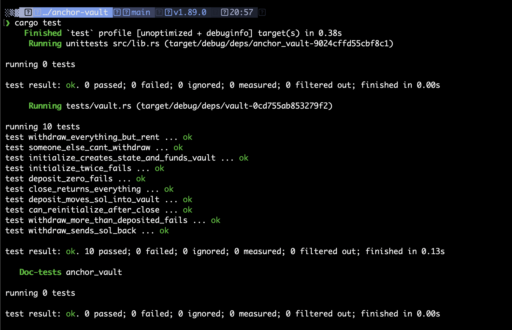

# anchor vault

Turbin3 Q4 builders assignment. Each user gets their own SOL vault they can deposit into, withdraw from, and close.

Built with Anchor 1.1.2, tests run on LiteSVM (Rust).

## how it works

Every user gets two PDAs:

- `vault_state`, seeds `["state", user]`. Owned by the program, only stores the two bumps so they don't have to be found again on every call.
- `vault`, seeds `["vault", vault_state]`. A plain system account with no data. This is where the SOL actually sits.

Nobody has a private key for `vault`. The only way to move SOL out of it is the program signing with the seeds (`CpiContext::new_with_signer` on a system transfer). And since the state seeds start from the user's key, a different signer just ends up deriving a different vault.

### instructions

| ix | what it does |
| --- | --- |
| `initialize` | creates `vault_state`, saves the bumps, and puts the rent exempt minimum into `vault` |
| `deposit(amount)` | user -> vault |
| `withdraw(amount)` | vault -> user, signed by the vault PDA. can't go below the rent minimum |
| `close` | sends every lamport in the vault back to the user and closes `vault_state` (`close = user`) |

`deposit` and `withdraw` need the same accounts so they share one `Payment` struct.

Why fund the vault in `initialize`: a system account with 0 lamports doesn't exist. If the first deposit was smaller than the rent exempt amount (~0.00089 SOL for 0 bytes) the tx would fail with an insufficient funds for rent error. Putting the rent in first means any deposit works, and withdraw just refuses to touch that reserve. `close` is the way to get all of it back.

## tests

`programs/anchor-vault/tests/vault.rs`. LiteSVM loads the compiled `.so` straight into an in-process VM, so there's no validator to start and the whole suite runs in about 0.1s.

- initialize creates the state, stores the right bumps, vault holds exactly rent
- initialize twice fails
- deposit (twice) adds up in the vault
- deposit 0 fails
- withdraw sends SOL back (checked down to the lamport, including the 5000 fee)
- withdraw everything except rent works
- withdraw 1 lamport more than deposited fails
- another wallet can't withdraw from my vault
- close returns everything, both accounts end up with 0 lamports
- can initialize again after closing

## run it

```bash
anchor build
cargo test
```

`anchor test` does the same (build + `cargo test`, the local validator is skipped in `Anchor.toml`).



## things i picked up

- A system owned PDA and a program owned PDA close differently. `vault_state` belongs to the program, so `close = user` handles it. `vault` belongs to the system program, so you can't close it like that. You move all its lamports out with a signed transfer and the runtime deletes it.
- The bumps are saved in state, so the later instructions use `bump = vault_state.vault_bump` and don't have to run `find_program_address` again, which saves compute.
- `ctx.bumps` in Anchor gives you the canonical bumps for free during init.
- In LiteSVM tests you have to call `expire_blockhash()` between identical transactions. Otherwise the second one is rejected as already processed.
